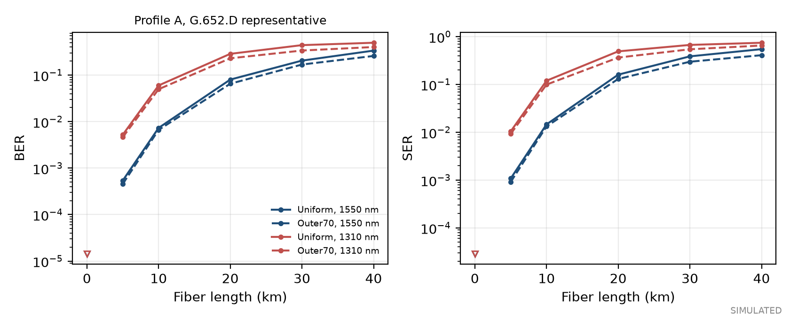
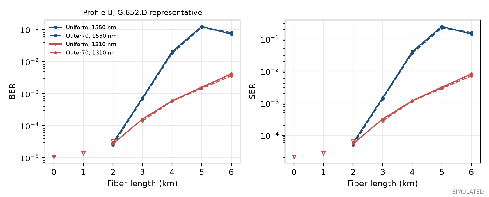
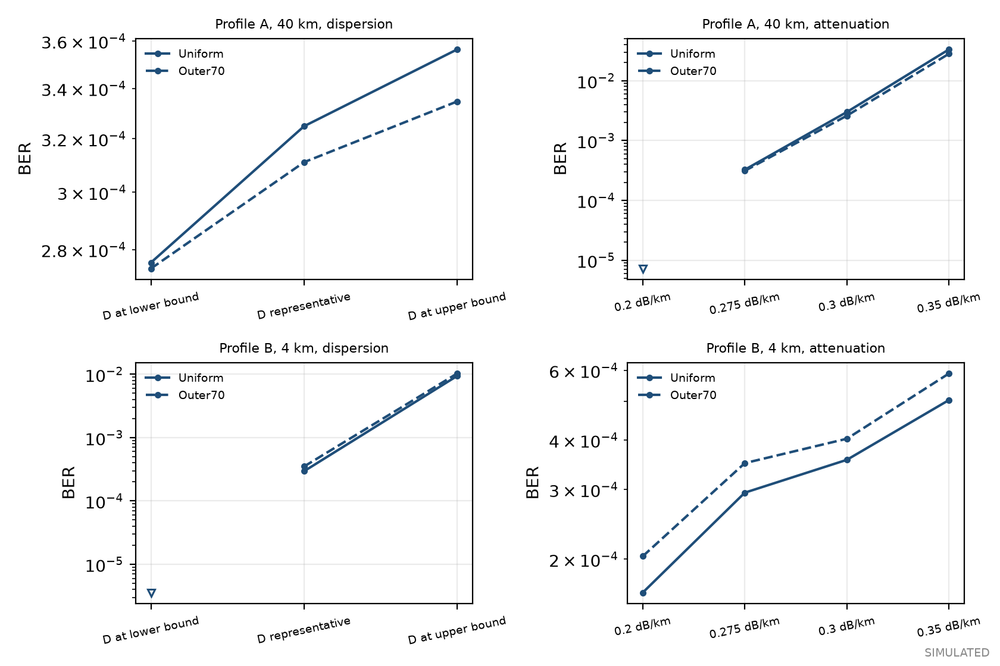
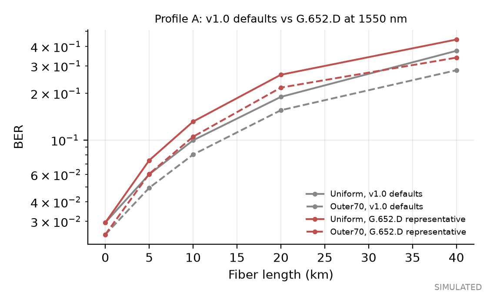
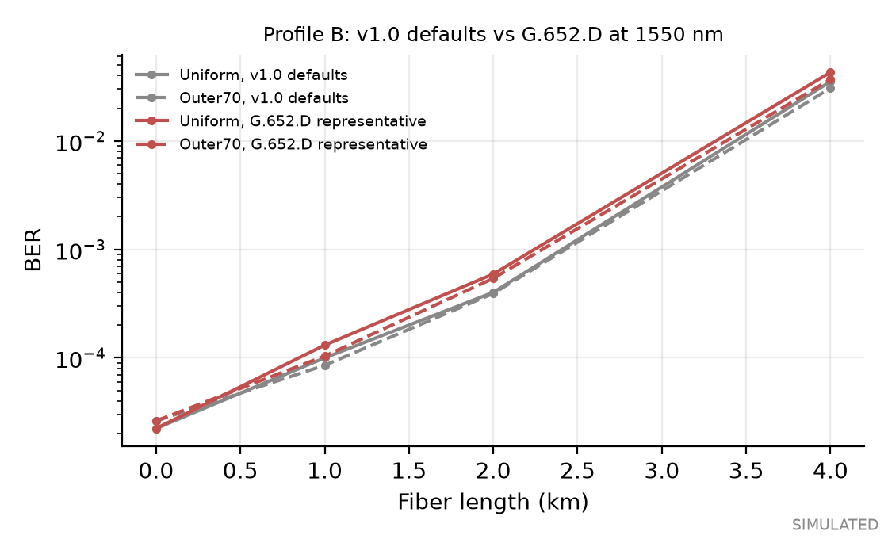

# OpticPS Fiber Model Validation Report

ITU-T G.652.D fiber model, OpticPS version 1.1.0

**SIMULATION AND SPECIFICATION ANALYSIS ONLY: NO MEASURED FIBER DATA. NOTHING HERE IS EXPERIMENTALLY VALIDATED.**

Configuration SHA-256 4a087b9e8662ad1bb6e71861f3002c57e0ea37e51d1bf3815fa303868036a5a8. Seed 42. Python 3.11.15, NumPy 2.4.6. Runtime 400 s.

## 1. Summary

OpticPS now offers a selectable fiber description with attenuation, chromatic dispersion and dispersion slope, and a third-order dispersion term in the field propagation. Presets follow Rec. ITU-T G.652 (08/2024). Each number records whether it is a specification limit, a representative simulation value, manufacturer data or a laboratory measurement.

- With no fiber selected, the link reproduces v1.0 exactly: 45 of 45 saved v1.0 fiber-sweep points were recomputed identically (symbol errors, bit errors, rates and powers).
- At the Profile A, Uniform, 40 km point, v1.0 defaults give SER 0.590072, BER 0.374823 (149850 symbol errors, -27.011 dBm received). The G.652.D representative preset at 1550 nm gives SER 0.673927, BER 0.443107 (171145 symbol errors, -30.011 dBm received).
- The simulated dispersion null agrees with theory to 3e-08 relative error in every case tested.

## 2. Standard and references

The model follows Rec. ITU-T G.652 (08/2024), edition 10.0, approved 2024-08-29, in force. Used: clause 6 (fibre attributes, Equations (6-1) to (6-3)), clause 7 (cable attributes), clause 8 (Table 2, G.652.D), and Appendix I (Table I.1, representative link values). The G.652.D variant is a deliberate default for presets only: nothing forces the simulation onto G.652.D, and a custom fiber description can describe any other type.

Equation (6-2a,b,c) reached the code through an extraction in which the signs and subscripts were garbled. The signs were reconstructed, and confirmed by continuity with Equation (6-3) at 1460 nm: the reconstructed bounds equal the values of Equation (6-3), 8.625 and 12.472 ps/(nm km), and they join continuously at lambda0 min and lambda0 max. This is consistency evidence, not a reading of the printed equation, and it should be checked against the printed Recommendation.

## 3. Equations and assumptions

Dispersion parameter D and slope S relate to the propagation constant through:

EQ: \beta_2=-\frac{D\lambda^2}{2\pi c},\qquad \beta_3=\frac{\lambda^4 S+2\lambda^3 D}{4\pi^2 c^2}

The field envelope A of E = A exp(-i omega0 t) acquires, for an optical frequency offset omega over length L:

EQ: A(\omega,L)=A(\omega,0)\,\exp\left[i\left(\frac{\beta_2}{2}\omega^2+\frac{\beta_3}{6}\omega^3\right)L\right]

numpy's FFT kernel is exp(-i omega t), so its frequency axis is minus the optical offset. The even term is unchanged and the odd term enters as exp(-i beta3 L omega_np^3 / 6). A test checks the sign: a pulse offset in frequency is delayed by beta3 omega^2 L / 2 on either side. A slope of exactly zero selects the v1.0 second-order model, with no third-order term at all, so existing results are unchanged. A non-zero slope adds the full beta3, including its 2 lambda^3 D part. Intensity detection of a double-sideband signal sees the cosine of the second-order phase, so the first null follows:

EQ: f_{\mathrm{null}}=\sqrt{\frac{c}{2\lambda^2 |D| L}}

When D is zero or the length is zero there is no null and the code returns infinity.

The G.652 three-term Sellmeier form and the bounds for 1460 nm to 1625 nm are:

EQ: D(\lambda)=\frac{S_0\lambda}{4}\left[1-\left(\frac{\lambda_0}{\lambda}\right)^4\right],\qquad 8.625+0.052(\lambda-1460)\leq D\leq 12.472+0.068(\lambda-1460)

The representative preset uses this form with lambda0 and S0 fitted so that D = 17 ps/(nm km) and S = 0.056 ps/(nm^2 km) at 1550 nm, the Table I.1 values. The fit gives lambda0 = 1307.6 nm and S0 = 0.0889 ps/(nm^2 km), inside Table 2. This is a model choice, not a value stated in the Recommendation. Its attenuation is the Table I.1 link value, joined linearly between bands, also an assumption.

Assumptions carried from the link model: single polarization; no polarization mode dispersion; no Kerr effect; no amplifier or laser noise; attenuation independent of power. PMD is listed in the tables and is not simulated.

## 4. ITU-T G.652.D attributes

Fibre attributes and cable attributes are kept apart because they apply to different things. The fibre values describe the glass; the cable values are limits for factory-length cable.

| Fibre attribute | Detail | Value |
|---|---|---|
| Mode field diameter | 1310 nm, nominal range | 8.6 to 9.2 um, tolerance 0.4 um |
| Cladding diameter | Nominal | 125.0 um, tolerance 0.7 um |
| Cable cut-off wavelength | Maximum | 1260 nm |
| Macrobending loss | 30 mm radius, 100 turns, 1625 nm | 0.1 dB maximum |
| Zero-dispersion wavelength | lambda0 min, max | 1300 nm, 1324 nm |
| Dispersion slope at lambda0 | S0 min, max | 0.073, 0.092 ps/(nm^2 km) |
| D at 1550 nm | Minimum, maximum | 13.3, 18.6 ps/(nm km) |
| D at 1625 nm | Minimum, maximum | 17.2, 23.7 ps/(nm km) |

| Cable attribute | Detail | Value |
|---|---|---|
| Attenuation coefficient | Maximum, 1310 to 1625 nm (Notes 1, 2) | 0.4 dB/km |
| Attenuation coefficient | Maximum at 1383 nm after hydrogen ageing (Note 3) | 0.4 dB/km |
| Attenuation coefficient | Maximum, 1530 to 1565 nm | 0.3 dB/km |
| PMD coefficient | PMD_Q, M = 20 cables, Q = 0.01% | 0.2 ps/sqrt(km) maximum |

Note 1 of Table 2 says the cable attenuation values should not be applied to short cables such as jumpers, indoor cables and drop cables. Note 2 extends the range to 1260 nm by adding 0.07 dB/km to the 1310 nm value; the Recommendation does not give the intermediate curve, so OpticPS applies the addition flat from 1260 to 1310 nm. Table I.1 gives typical values of concatenated links, which are not cable limits:

| Link attribute (Table I.1) | Wavelength | Typical link value |
|---|---|---|
| Attenuation coefficient | 1260 to 1360 nm | 0.5 dB/km |
| Attenuation coefficient | 1530 to 1565 nm | 0.275 dB/km |
| Attenuation coefficient | 1565 to 1625 nm | 0.35 dB/km |
| Chromatic dispersion D1550 | 1550 nm | 17 ps/(nm km) |
| Dispersion slope S1550 | 1550 nm | 0.056 ps/(nm^2 km) |

The Table I.1 typical link value of 0.5 dB/km at 1310 nm is above the Table 2 cable limit of 0.40 dB/km because it is a link value, which includes splices and connectors, and not a cable limit. The representative preset therefore reports itself outside the Table 2 cable attenuation limit at 1310 nm, and the code says so instead of hiding it.

## 5. Attenuation and dispersion

![Attenuation, Table 2 cable limit and Table I.1 typical link value [analytical]](../results/fiber_validation/figures/attenuation_vs_wavelength.png)

![Dispersion bounds and representative curve, 1260 to 1625 nm [analytical]](../results/fiber_validation/figures/dispersion_vs_wavelength.png)

The representative curve gives D = 17.000 ps/(nm km) at 1550 nm, inside the bounds 13.30 to 18.59, and D = 0.211 ps/(nm km) at 1310 nm. The representative curve stays inside the bounds over 1260 to 1625 nm: True. The bounds are a worst-case envelope. A limit preset sits on one bound with attenuation at the Table 2 maximum, and is not a real fiber.

## 6. BER and SER sensitivity

All results in this section are simulated, through the link and the full receiver, on the same frames and seeds as the v1.0 demonstration. They are not measurements. Intervals and error counts follow the conventions of the main report: points with fewer than 10 symbol errors are drawn as hollow upper bounds.

### Length at 1550 nm and 1310 nm

Representative preset, excess loss fixed at 18 dB (Profile A) and 13 dB (Profile B), mean of 4 runs. At 1310 nm, D is 0.21 ps/(nm km), so dispersion hardly matters and the attenuation of 0.5 dB/km dominates. At 1550 nm the loss is lower but dispersion limits the bandwidth. For Profile B at 1550 nm the error count is not monotonic in length, which is consistent with the dispersion null moving through the signal band as the length grows.

| Wavelength (nm) | Waveform | Length (km) | Received (dBm) | SER | BER | Errors |
|---|---|---|---|---|---|---|
| 1550 | Uniform | 0 | -15.01 | 0 | 0 | 0 |
| 1550 | Uniform | 5 | -16.39 | 1.08e-03 | 5.39e-04 | 137 |
| 1550 | Uniform | 10 | -17.76 | 1.46e-02 | 7.30e-03 | 1855 |
| 1550 | Uniform | 20 | -20.51 | 1.60e-01 | 8.01e-02 | 20329 |
| 1550 | Uniform | 30 | -23.26 | 3.86e-01 | 2.05e-01 | 49055 |
| 1550 | Uniform | 40 | -26.01 | 5.47e-01 | 3.36e-01 | 69436 |
| 1550 | Outer70 | 0 | -15.01 | 0 | 0 | 0 |
| 1550 | Outer70 | 5 | -16.39 | 9.14e-04 | 4.57e-04 | 116 |
| 1550 | Outer70 | 10 | -17.76 | 1.32e-02 | 6.62e-03 | 1682 |
| 1550 | Outer70 | 20 | -20.51 | 1.30e-01 | 6.52e-02 | 16556 |
| 1550 | Outer70 | 30 | -23.26 | 2.98e-01 | 1.69e-01 | 37895 |
| 1550 | Outer70 | 40 | -26.01 | 4.09e-01 | 2.58e-01 | 51899 |
| 1310 | Uniform | 0 | -15.01 | 0 | 0 | 0 |
| 1310 | Uniform | 5 | -17.51 | 1.04e-02 | 5.21e-03 | 1324 |
| 1310 | Uniform | 10 | -20.01 | 1.20e-01 | 5.99e-02 | 15199 |
| 1310 | Uniform | 20 | -25.01 | 4.91e-01 | 2.87e-01 | 62408 |
| 1310 | Uniform | 30 | -30.01 | 6.70e-01 | 4.41e-01 | 85103 |
| 1310 | Uniform | 40 | -35.01 | 7.44e-01 | 4.96e-01 | 94436 |
| 1310 | Outer70 | 0 | -15.01 | 0 | 0 | 0 |
| 1310 | Outer70 | 5 | -17.51 | 9.24e-03 | 4.62e-03 | 1173 |
| 1310 | Outer70 | 10 | -20.01 | 9.93e-02 | 4.96e-02 | 12606 |
| 1310 | Outer70 | 20 | -25.01 | 3.64e-01 | 2.30e-01 | 46264 |
| 1310 | Outer70 | 30 | -30.01 | 5.43e-01 | 3.37e-01 | 68933 |
| 1310 | Outer70 | 40 | -35.01 | 6.51e-01 | 4.02e-01 | 82709 |

| Wavelength (nm) | Waveform | Length (km) | Received (dBm) | SER | BER | Errors |
|---|---|---|---|---|---|---|
| 1550 | Uniform | 0 | -10.01 | 3.88e-06 | 1.94e-06 | 1 |
| 1550 | Uniform | 1 | -10.28 | 7.75e-06 | 3.88e-06 | 2 |
| 1550 | Uniform | 2 | -10.56 | 5.81e-05 | 2.91e-05 | 15 |
| 1550 | Uniform | 3 | -10.83 | 1.46e-03 | 7.32e-04 | 378 |
| 1550 | Uniform | 4 | -11.11 | 4.04e-02 | 2.02e-02 | 10436 |
| 1550 | Uniform | 5 | -11.38 | 2.47e-01 | 1.24e-01 | 63673 |
| 1550 | Uniform | 6 | -11.66 | 1.43e-01 | 7.13e-02 | 36799 |
| 1550 | Outer70 | 0 | -10.01 | 3.88e-06 | 1.94e-06 | 1 |
| 1550 | Outer70 | 1 | -10.29 | 7.75e-06 | 3.88e-06 | 2 |
| 1550 | Outer70 | 2 | -10.56 | 5.04e-05 | 2.52e-05 | 13 |
| 1550 | Outer70 | 3 | -10.84 | 1.38e-03 | 6.88e-04 | 355 |
| 1550 | Outer70 | 4 | -11.11 | 3.61e-02 | 1.81e-02 | 9327 |
| 1550 | Outer70 | 5 | -11.39 | 2.24e-01 | 1.15e-01 | 57786 |
| 1550 | Outer70 | 6 | -11.66 | 1.59e-01 | 7.99e-02 | 41157 |
| 1310 | Uniform | 0 | -10.01 | 3.88e-06 | 1.94e-06 | 1 |
| 1310 | Uniform | 1 | -10.51 | 7.75e-06 | 3.88e-06 | 2 |
| 1310 | Uniform | 2 | -11.01 | 5.43e-05 | 2.71e-05 | 14 |
| 1310 | Uniform | 3 | -11.51 | 3.22e-04 | 1.61e-04 | 83 |
| 1310 | Uniform | 4 | -12.01 | 1.19e-03 | 5.93e-04 | 306 |
| 1310 | Uniform | 5 | -12.51 | 3.15e-03 | 1.57e-03 | 812 |
| 1310 | Uniform | 6 | -13.01 | 8.15e-03 | 4.07e-03 | 2102 |
| 1310 | Outer70 | 0 | -10.01 | 3.88e-06 | 1.94e-06 | 1 |
| 1310 | Outer70 | 1 | -10.51 | 7.75e-06 | 3.88e-06 | 2 |
| 1310 | Outer70 | 2 | -11.01 | 3.49e-05 | 1.74e-05 | 9 |
| 1310 | Outer70 | 3 | -11.51 | 2.83e-04 | 1.41e-04 | 73 |
| 1310 | Outer70 | 4 | -12.01 | 1.17e-03 | 5.83e-04 | 301 |
| 1310 | Outer70 | 5 | -12.51 | 2.88e-03 | 1.44e-03 | 744 |
| 1310 | Outer70 | 6 | -13.01 | 7.12e-03 | 3.56e-03 | 1837 |

### Sensitivity to D and to attenuation

At 1550 nm, one point per profile. D is set to the lower and upper G.652.D bound with attenuation held at the representative value; then attenuation is varied with D held. These are envelope tests, not predictions for a fiber.

Profile A, 40 km, dispersion:

| Case | Waveform | SER | BER | Symbol errors |
|---|---|---|---|---|
| D at lower bound | Uniform | 5.51e-04 | 2.76e-04 | 140 |
| D at lower bound | Outer70 | 5.47e-04 | 2.74e-04 | 139 |
| D representative | Uniform | 6.50e-04 | 3.25e-04 | 165 |
| D representative | Outer70 | 6.22e-04 | 3.11e-04 | 158 |
| D at upper bound | Uniform | 7.13e-04 | 3.56e-04 | 181 |
| D at upper bound | Outer70 | 6.69e-04 | 3.35e-04 | 170 |

Profile A, attenuation:

| Case | Waveform | SER | BER | Symbol errors |
|---|---|---|---|---|
| 0.2 dB/km | Uniform | 0 | 0 | 0 |
| 0.2 dB/km | Outer70 | 0 | 0 | 0 |
| 0.275 dB/km | Uniform | 6.50e-04 | 3.25e-04 | 165 |
| 0.275 dB/km | Outer70 | 6.22e-04 | 3.11e-04 | 158 |
| 0.3 dB/km | Uniform | 5.98e-03 | 2.99e-03 | 1519 |
| 0.3 dB/km | Outer70 | 5.19e-03 | 2.60e-03 | 1319 |
| 0.35 dB/km | Uniform | 6.64e-02 | 3.32e-02 | 16871 |
| 0.35 dB/km | Outer70 | 5.62e-02 | 2.81e-02 | 14267 |

Profile B, 4 km, dispersion:

| Case | Waveform | SER | BER | Symbol errors |
|---|---|---|---|---|
| D at lower bound | Uniform | 0 | 0 | 0 |
| D at lower bound | Outer70 | 0 | 0 | 0 |
| D representative | Uniform | 5.89e-04 | 2.95e-04 | 304 |
| D representative | Outer70 | 6.99e-04 | 3.50e-04 | 361 |
| D at upper bound | Uniform | 1.88e-02 | 9.40e-03 | 9707 |
| D at upper bound | Outer70 | 2.05e-02 | 1.03e-02 | 10595 |

Profile B, attenuation:

| Case | Waveform | SER | BER | Symbol errors |
|---|---|---|---|---|
| 0.2 dB/km | Uniform | 3.29e-04 | 1.65e-04 | 170 |
| 0.2 dB/km | Outer70 | 4.07e-04 | 2.03e-04 | 210 |
| 0.275 dB/km | Uniform | 5.89e-04 | 2.95e-04 | 304 |
| 0.275 dB/km | Outer70 | 6.99e-04 | 3.50e-04 | 361 |
| 0.3 dB/km | Uniform | 7.13e-04 | 3.57e-04 | 368 |
| 0.3 dB/km | Outer70 | 8.06e-04 | 4.03e-04 | 416 |
| 0.35 dB/km | Uniform | 1.01e-03 | 5.05e-04 | 521 |
| 0.35 dB/km | Outer70 | 1.18e-03 | 5.89e-04 | 608 |

### Before and after: v1.0 defaults and G.652.D at 1550 nm

Identical configuration, seed, waveforms, frames and per-point noise seeds as the v1.0 fiber sweep of configs/demo.yaml. The v1.0 arm re-computed 25 of 25 Profile A and 20 of 20 Profile B saved points identically, so the comparison starts from the same code. Single point: Profile A, Uniform, 40 km. v1.0: SER 0.590072, BER 0.374823, 149850 symbol errors, 190374 bit errors, R_BMD 0.1959, received -27.011 dBm. G.652.D: SER 0.673927, BER 0.443107, 171145 symbol errors, 225056 bit errors, R_BMD 0.0424, received -30.011 dBm.

Profile A, Uniform:

| Fiber | Length (km) | Received (dBm) | SER | BER | Symbol errors |
|---|---|---|---|---|---|
| v1.0 defaults | 0 | -19.01 | 5.89e-02 | 2.94e-02 | 14947 |
| G.652.D representative | 0 | -19.01 | 5.89e-02 | 2.94e-02 | 14947 |
| v1.0 defaults | 5 | -20.01 | 1.20e-01 | 6.01e-02 | 30528 |
| G.652.D representative | 5 | -20.39 | 1.48e-01 | 7.40e-02 | 37565 |
| v1.0 defaults | 10 | -21.01 | 1.99e-01 | 9.95e-02 | 50480 |
| G.652.D representative | 10 | -21.76 | 2.61e-01 | 1.31e-01 | 66237 |
| v1.0 defaults | 20 | -23.01 | 3.63e-01 | 1.89e-01 | 92208 |
| G.652.D representative | 20 | -24.51 | 4.66e-01 | 2.63e-01 | 118243 |
| v1.0 defaults | 40 | -27.01 | 5.90e-01 | 3.75e-01 | 149850 |
| G.652.D representative | 40 | -30.01 | 6.74e-01 | 4.43e-01 | 171145 |

Profile B, Uniform:

| Fiber | Length (km) | Received (dBm) | SER | BER | Symbol errors |
|---|---|---|---|---|---|
| v1.0 defaults | 0 | -11.01 | 4.46e-05 | 2.23e-05 | 23 |
| G.652.D representative | 0 | -11.01 | 4.46e-05 | 2.23e-05 | 23 |
| v1.0 defaults | 1 | -11.21 | 2.00e-04 | 9.98e-05 | 103 |
| G.652.D representative | 1 | -11.28 | 2.62e-04 | 1.31e-04 | 135 |
| v1.0 defaults | 2 | -11.41 | 8.02e-04 | 4.01e-04 | 414 |
| G.652.D representative | 2 | -11.56 | 1.18e-03 | 5.92e-04 | 611 |
| v1.0 defaults | 4 | -11.81 | 7.05e-02 | 3.53e-02 | 36405 |
| G.652.D representative | 4 | -12.11 | 8.60e-02 | 4.30e-02 | 44367 |

Why the results differ. The attenuation of the preset is 0.275 dB/km against 0.2 dB/km, so the span loses 0.075 dB more per km. The dispersion at 1550 nm is the same 17 ps/(nm km) and the slope is the only other change. Two further arms isolated each change on Uniform and Outer70:

- Profile A: With only the slope added, symbol-error counts were identical to v1.0 at all 10 points. With only the attenuation changed, the change in symbol errors was within 10% (plus one error) of the full preset's change at 8 of 8 points with fiber.
- Profile B: With only the slope added, symbol-error counts equalled v1.0 at 6 of 8 points and differed by at most 8 symbol errors. With only the attenuation changed, the change in symbol errors was within 10% (plus one error) of the full preset's change at 6 of 6 points with fiber.

The slope-only arm changed symbol errors by at most 8; compare section 7.

## 7. Numerical validation

The first null of the simulated intensity response of a small tone through the dispersion routine is compared with theory. The grid is not aligned to the theoretical null, and the null is found by intersecting the two sides of the response. Relative error is at most 3.1e-08.

| Wavelength (nm) | Variant | D (ps/(nm km)) | Theory (GHz) | Simulated (GHz) | Relative error | Null shift from slope (GHz) |
|---|---|---|---|---|---|---|
| 1550 | representative | 17.000 | 19.1575 | 19.1575 | -3.1e-08 | 0.0e+00 |
| 1310 | representative | 0.211 | 203.6730 | 203.6730 | -3.1e-08 | 2.2e-09 |
| 1550 | limit-low | 13.305 | 21.6549 | 21.6549 | -3.1e-08 | 0.0e+00 |
| 1550 | limit-high | 18.592 | 18.3190 | 18.3190 | -3.1e-08 | 0.0e+00 |

A slope changes only the phase of the sidebands of a double-sideband signal, not the magnitude of the intensity response, to first order. The largest change in response magnitude at half the null frequency was 9.6e-08. The size of the third-order phase at the Nyquist frequency of each profile, at the longest sweep length, against the second-order phase:

| Profile | Length (km) | Baud (GBd) | beta3 (ps^3/km) | beta3 from D only | 2nd-order phase (rad) | 3rd-order phase (rad) |
|---|---|---|---|---|---|---|
| profile_A | 40 | 8 | 0.1268 | 0.0357 | 0.274 | 1.34e-05 |
| profile_B | 6 | 56 | 0.1268 | 0.0357 | 2.013 | 6.90e-04 |

Here beta3 is in ps^3/km. The third-order phase is some orders of magnitude below the second-order phase, so the third-order term is expected to be negligible for these baud rates, which the before and after results confirm. It would matter for much wider bandwidths or near the zero-dispersion wavelength.

## 8. Limitations and experimental data still required

- The Southampton link's fiber type and length are unconfirmed. Nothing here describes it.
- The Table 2 limits are for cable, and exclude short cables such as jumpers (Note 1). A short bench link is not covered by them.
- PMD is listed and not simulated; no polarization effects are modelled.
- No Kerr effect, no amplifier, no laser chirp. Real transmitters add chirp that interacts with dispersion.
- Connector and splice losses, and bend loss, are not modelled except through the excess loss term.
- The representative curves are models built from Table I.1, not a measurement of any fiber.
- Needed from Southampton: fiber type and manufacturer data sheet, link length, attenuation measured at the operating wavelength, dispersion or a group delay measurement, and the laser wavelength. These enter through apply_measurements, which marks them as laboratory-measured.

## 9. What is analytical, simulated and experimentally validated

| Item | Status |
|---|---|
| G.652.D limits, bounds, Table I.1 curves, third-order phase sizes | Analytical |
| BER and SER versus length, sensitivity, before and after, dispersion null | Simulated |
| Any statement about the Southampton link or any real fiber | Not experimentally validated. No measured data has been imported. |

## 10. References

1. Recommendation ITU-T G.652 (08/2024), Characteristics of a single-mode optical fibre and cable, edition 10.0, approved 2024-08-29, in force. Clauses 6 to 8, Tables 1 and 2, Equations (6-1) to (6-3), Appendix I and Table I.1.
2. G. P. Agrawal, Nonlinear Fiber Optics, Academic Press. Used for the sign convention of the dispersion phase only.
3. J. Wang and K. Petermann, Small signal analysis for dispersive optical fiber communication systems, J. Lightw. Technol. 10(1):96-100, 1992. doi:10.1109/50.108743
4. Recommendations ITU-T G.650.1, G.650.2 and Supplement 39 are cited by G.652 for test methods and system design. They were not read for this work.

## 11. Reproducibility

Command: uv run opticps fiber-validate. Configuration: configs/fiber_validation.yaml and configs/demo.yaml. Data: results/fiber_validation/fiber_results.json. Standard: Rec. ITU-T G.652 (08/2024), edition 10.0.
