# OpticPS Research Report

An Open-Source Framework for Probabilistic Shaping in Optical Communications

**SIMULATION RESULTS ONLY — NO SOUTHAMPTON MEASUREMENTS HAVE BEEN IMPORTED.**

Software version 1.0.0. Configuration SHA-256 e39084adac9d4a0e496a65fc2b0f0e205b356dc254c314c16c0e6293eb24f9c2. Seed 42.

## 1. Executive summary

OpticPS generates Keysight M8199B candidate waveforms for Uniform, Fixed-shaped and Adaptive-shaped PAM4, and simulates, receives and compares them. Hardware playback has not been verified, and no fiber measurement exists.

The main finding is a warning about the requested distributions. Under a fixed drive swing, which is the natural constraint for an unamplified Mach-Zehnder link, PS70 and PS80 place more symbols on inner levels and stayed at or below Uniform at every PSNR computed. Wiegart et al. [1] show the optimum under this constraint is outer-heavy, and this work reproduces that result. At a PSNR of 14 dB the calculated SMD rates are Uniform 1.035, PS70 0.869, PS80 0.745, Outer70 1.101 bit/symbol.

In simulated back-to-back transmission at Profile A, near -22.0 dBm received power:

- PS70 (inner) versus Uniform: lower: -0.150 bit/symbol (95% CI -0.151 to -0.147).
- PS80 (inner) versus Uniform: lower: -0.267 bit/symbol (95% CI -0.270 to -0.264).
- Adaptive versus Uniform: higher by +0.036 bit/symbol (95% CI +0.033 to +0.039).
- Outer70 versus Uniform: higher by +0.041 bit/symbol (95% CI +0.037 to +0.045).

The exported Adaptive waveform is simulation-optimized, not adapted to any measurement.

## 2. Research objectives and hypotheses

Objective: compare the three schemes fairly, separating physical constraints from information-theoretic ones.

- H1: under fixed peak swing, inner-heavy distributions lose to Uniform at every operating point. Supported in this model.
- H2: an outer-heavy distribution beats Uniform near 1 bit/symbol. To be tested experimentally.
- H3: adaptation adds value over one good fixed distribution. Tested in simulation in section 12.

## 3. Background and related work

Probabilistic shaping with PAS [3] gained wide use in coherent systems under an average power constraint. IM/DD differs because the signal is non-negative. He et al. [8] reported receiver-sensitivity gains with exponential-like PAM distributions, but noted a launch power penalty at equal extinction ratio. Wiegart et al. [1] add a peak constraint from modulator extinction, and show optimal symmetric, outer-heavy input. Peak-limited channels favour discrete inputs with mass near the boundary [6].

## 4. Theoretical foundation

Maxwell-Boltzmann probabilities:

EQ: P(x_i)=\frac{e^{-\lambda |x_i|^2}}{Z},\quad x_i\in\{-3,-1,+1,+3\}

Here lambda = 0 is uniform; lambda > 0 is inner-heavy; lambda < 0 is outer-heavy. Rates follow [1, 3]:

EQ: R_{\mathrm{SMD}}=I(X;Y),\quad R_{\mathrm{BMD}}=\left[H(X)-\sum_k H(B_k|Y)\right]^+

PSNR is 9 / sigma squared on the alphabet {0, 1, 2, 3}, as in [1]. MAP detection uses:

EQ: \hat{x}=\arg\max_x\ p(y|x)\,P(x)

Reproduction of [1]: Uniform reaches 1 bit/symbol at 13.69 dB (SMD) and 13.85 dB (BMD). Outer70 gains 0.73 dB and 0.63 dB. The paper gives 0.63 dB for the same BMD case. The rates quoted in section 1 are SMD; the figure below plots BMD.

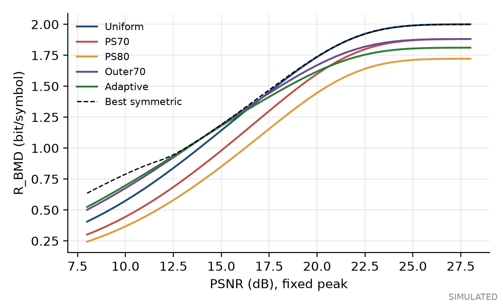

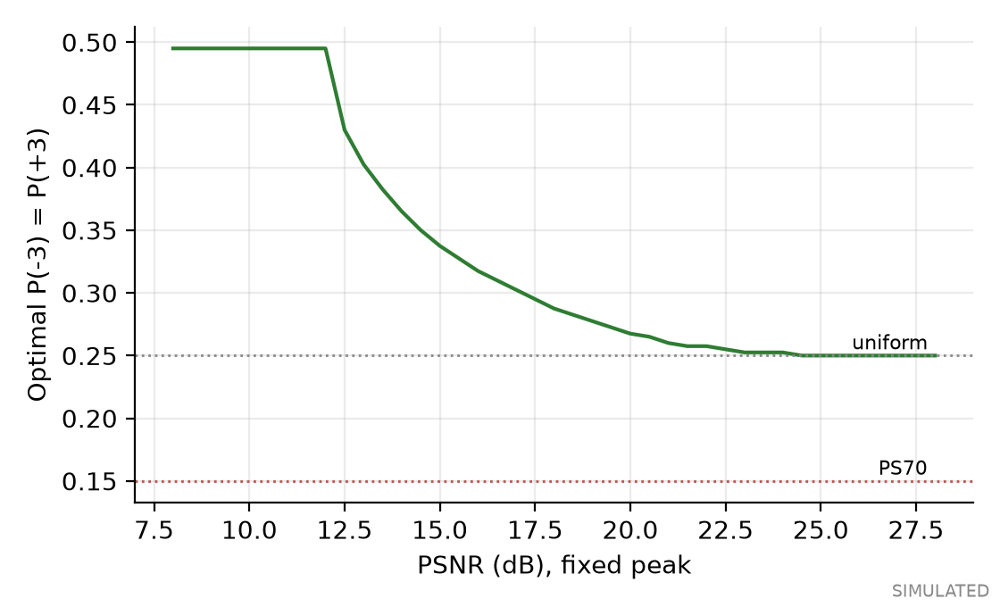

## 5. Probabilistic shaping methodology

Shaped symbols come from a reversible matcher, not independent sampling. Fixed shaping uses the requested PS70 and PS80, plus the literature benchmark Outer70. The adaptive search spans the whole symmetric family, covering positive and negative lambda, because limiting it to positive lambda would exclude the known optimum.

The exported Adaptive distribution uses P(+-3) = 0.375, lambda = -0.1373, chosen at the design point where Uniform reaches R_BMD = 1.0 (13.854 dB). Near error-free operating points the same search returns nearly uniform input and shaping gain vanishes.

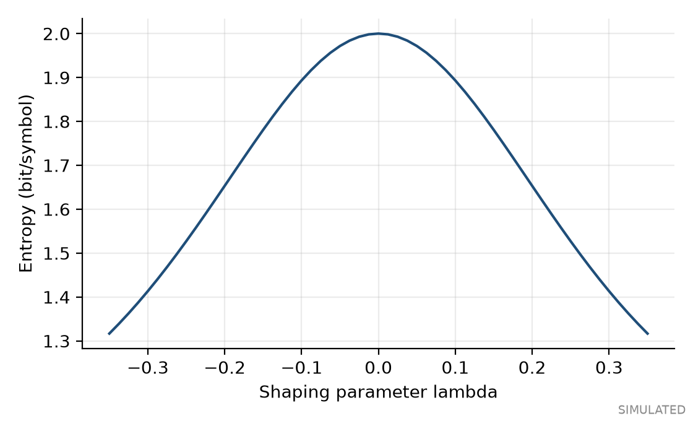

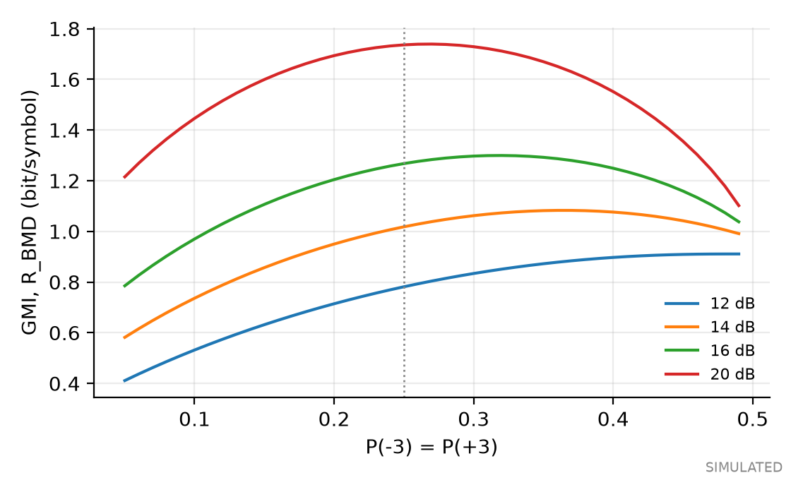

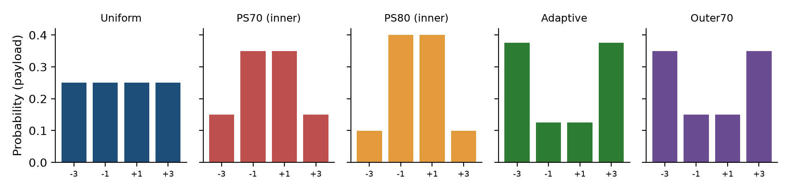

## 6. Distribution matching

CCDM [2] is implemented as an exact enumerative code [5]: the lexicographic rank of a multiset permutation, using exact integers, with k = floor(log2(multinomial)). Blocks are 1024 symbols. Compositions are rounded to integers, so targets are approached, not met exactly: PS70 becomes 154/358/358/154 of 1024.

One symbol error makes a block undecodable or wrong, and no FEC is implemented. Post-matcher BER is thus diagnostic only. This system is not PAS.

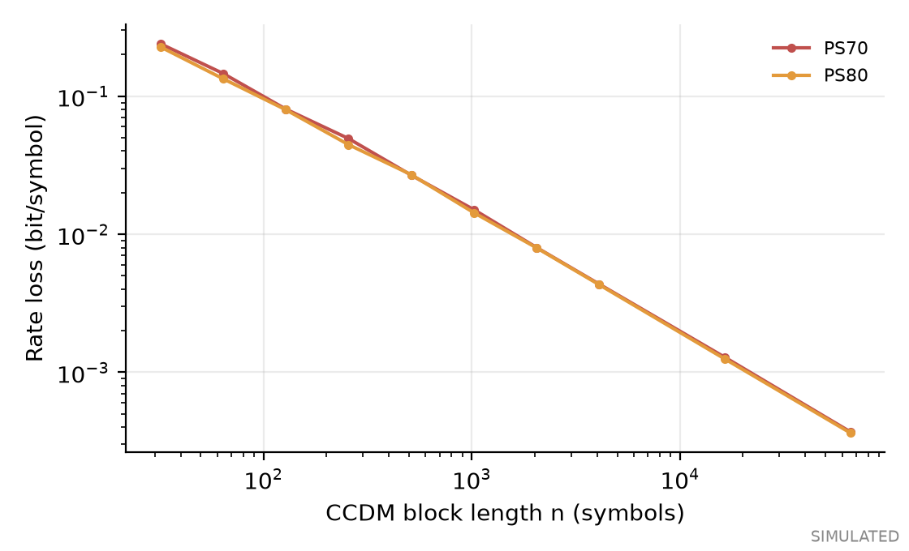

## 7. Experimental setup

PLACEHOLDER: no Southampton experiment has been run. The intended setup is M8199B, driver as required, Mach-Zehnder modulator, VOA and fiber (fiber standard and length unconfirmed), photodiode, and a receiver that is a Keysight Infiniium UXR Series oscilloscope (256 GSa/s, model suffix unconfirmed). Complete this section from the experiment log. The procedure is in output/README_SOUTHAMPTON.md.

## 8. Keysight waveform generation

Files follow the rules in docs/HARDWARE_COMPATIBILITY.md: first row DataOut1, one column, values within -1 to +1, sample count a multiple of 512. The rules came from the project owner's notes of the Programming Guide, which could not be read directly. Profile A is 224 GSa/s, 8 GBaud, 917,504 samples. Profile B is 224 GSa/s, 56 GBaud, 262,144 samples. All waveforms in a group share one data-independent full scale, so levels map to the same voltages.

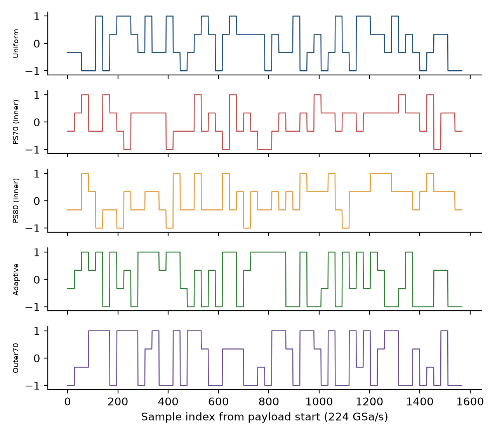

## 9. Optical channel model

The simulation uses a sine-law modulator with finite extinction, fiber attenuation, chromatic dispersion as an all-pass phase, square-law detection, thermal noise, level-dependent shot noise and receiver filtering. It omits laser noise, Kerr effects, and amplifiers. Electrical symbol energy is not treated as optical power: all optical values come from the field. For a symmetric drive at quadrature, mean power and OMA are equal across distributions; bias error and compression break this.

### Fiber model, ITU-T G.652.D (version 1.1.0)

The link can use a selectable fiber description with attenuation, dispersion and dispersion slope, each tagged with its provenance. The g652d-representative preset follows Rec. ITU-T G.652 (08/2024) Table I.1 and a three-term dispersion curve fitted to it; the limit presets sit on the Table 2 dispersion bounds. No fiber type is applied unless selected, and the Southampton fiber type and length are unconfirmed. The simulated results in section 12 of this report use the v1.0 defaults of 0.2 dB/km and 17 ps/(nm km) with no slope, and are unchanged.

Re-running the v1.0 fiber sweep with the same seed and waveforms reproduced 45 of 45 saved points exactly. Replacing the defaults by the representative G.652.D values at 1550 nm changes attenuation from 0.2 to 0.275 dB/km. Details are in reports/Fiber_Model_Validation_Report.pdf. Nothing in it is experimentally validated.

![Dispersion bounds and representative curve, ITU-T G.652.D, 1260 to 1625 nm [analytical]](../results/fiber_validation/figures/dispersion_vs_wavelength.png)

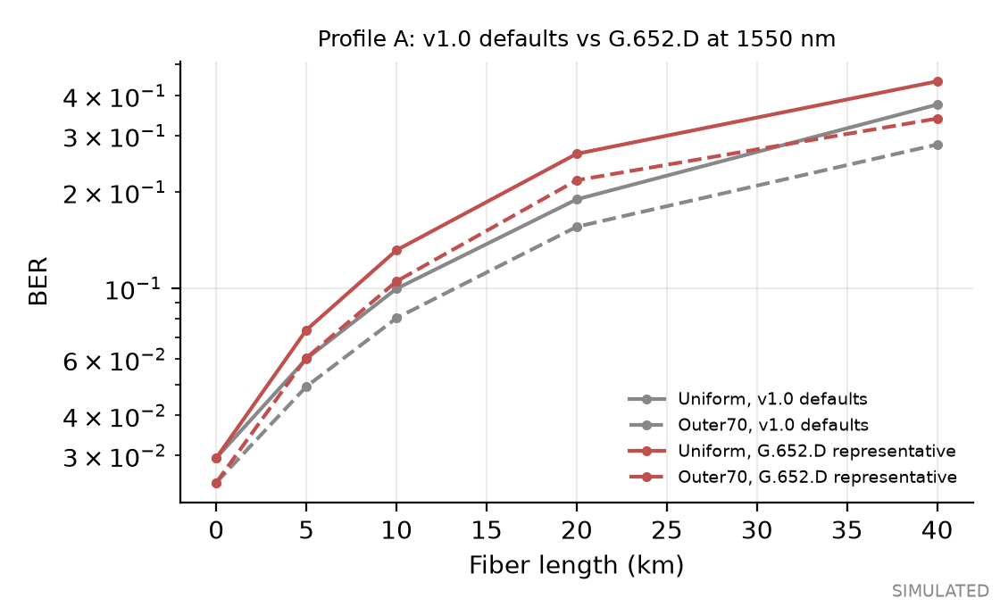

## 10. Receiver DSP

Resampling, matched filter, circular preamble correlation with polarity detection, phase search, preamble calibration, a 15-tap FFE, and detection. All fitting uses preamble and training symbols only. Metrics are SER, Gray label BER, and R_SMD and R_BMD estimated with the training-fitted channel law.

## 11. Fair comparison methodology

Protocol A holds baud, alphabet, drive swing and link fixed. Protocol B matches net rate. Launch power, received power, OMA, extinction ratio, electrical swing and RMS are recorded separately. The simulated values at the Profile A reference point are:

| Waveform | Launch (dBm) | Received (dBm) | OMA (dBm) | ER (dB) |
|---|---|---|---|---|
| Uniform | 2.989 | -22.011 | 4.855 | 8.827 |
| PS70 (inner) | 2.990 | -22.010 | 4.855 | 8.827 |
| PS80 (inner) | 2.990 | -22.010 | 4.855 | 8.827 |
| Adaptive | 2.990 | -22.010 | 4.855 | 8.827 |
| Outer70 | 2.990 | -22.010 | 4.855 | 8.827 |

Noise seeds are shared across waveforms at each point, making runs paired. Rates near the top of a sweep reflect the entropy ceiling, not better detection.

## 12. Uniform versus fixed versus adaptive results

All values are simulated, mean of 8 runs with bootstrap intervals over runs. Rates are achievable with ideal coding, not delivered throughput.

### Profile A, 8 GBaud, near -22.0 dBm

| Waveform | R_BMD (bit/sym) | Achievable rate (Gbit/s) | SER | BER | Errors |
|---|---|---|---|---|---|
| Uniform | 1.089 [1.086, 1.091] | 8.71 | 2.79e-01 | 1.41e-01 | 70884 |
| PS70 (inner) | 0.939 [0.936, 0.943] | 7.51 | 2.87e-01 | 1.44e-01 | 72793 |
| PS80 (inner) | 0.822 [0.818, 0.825] | 6.58 | 2.66e-01 | 1.34e-01 | 67642 |
| Adaptive | 1.125 [1.122, 1.128] | 9.00 | 1.98e-01 | 1.03e-01 | 50360 |
| Outer70 | 1.130 [1.125, 1.134] | 9.04 | 2.23e-01 | 1.15e-01 | 56693 |

- PS70 (inner) versus Uniform: lower: -0.150 bit/symbol (95% CI -0.151 to -0.147).
- PS80 (inner) versus Uniform: lower: -0.267 bit/symbol (95% CI -0.270 to -0.264).
- Adaptive versus Uniform: higher by +0.036 bit/symbol (95% CI +0.033 to +0.039).
- Outer70 versus Uniform: higher by +0.041 bit/symbol (95% CI +0.037 to +0.045).

### Profile B, 56 GBaud, near -19.0 dBm

| Waveform | R_BMD (bit/sym) | Achievable rate (Gbit/s) | SER | BER | Errors |
|---|---|---|---|---|---|
| Uniform | 0.790 [0.787, 0.793] | 44.24 | 3.80e-01 | 2.00e-01 | 196296 |
| PS70 (inner) | 0.649 [0.646, 0.651] | 36.33 | 3.86e-01 | 1.97e-01 | 199192 |
| PS80 (inner) | 0.554 [0.551, 0.557] | 31.01 | 3.57e-01 | 1.81e-01 | 184061 |
| Adaptive | 0.883 [0.881, 0.885] | 49.46 | 2.59e-01 | 1.50e-01 | 133750 |
| Outer70 | 0.871 [0.870, 0.873] | 48.80 | 2.94e-01 | 1.66e-01 | 151950 |

- PS70 (inner) versus Uniform: lower: -0.141 bit/symbol (95% CI -0.143 to -0.139).
- PS80 (inner) versus Uniform: lower: -0.236 bit/symbol (95% CI -0.238 to -0.234).
- Adaptive versus Uniform: higher by +0.093 bit/symbol (95% CI +0.090 to +0.097).
- Outer70 versus Uniform: higher by +0.081 bit/symbol (95% CI +0.078 to +0.084).

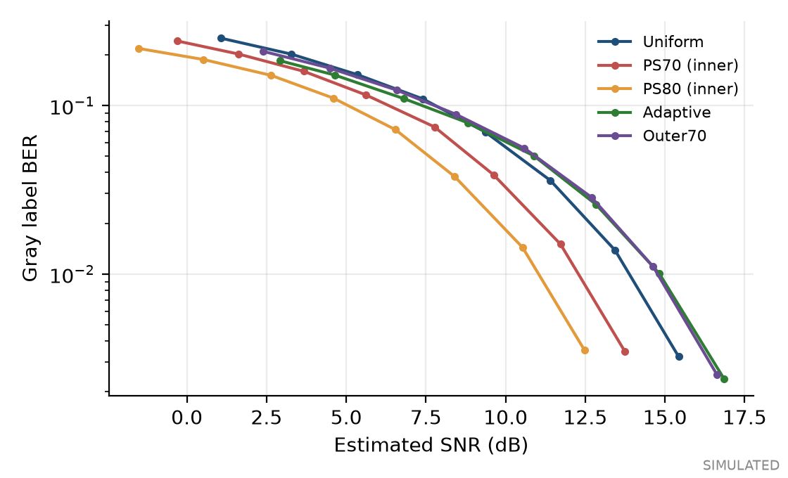

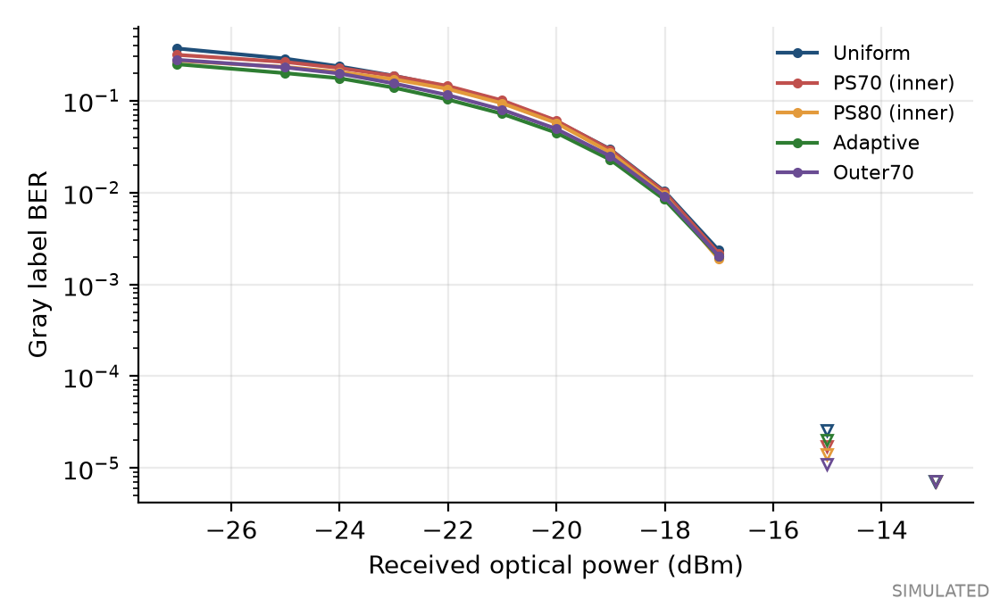

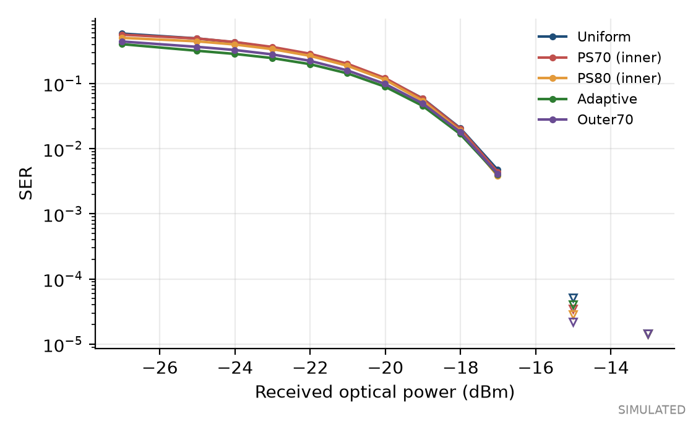

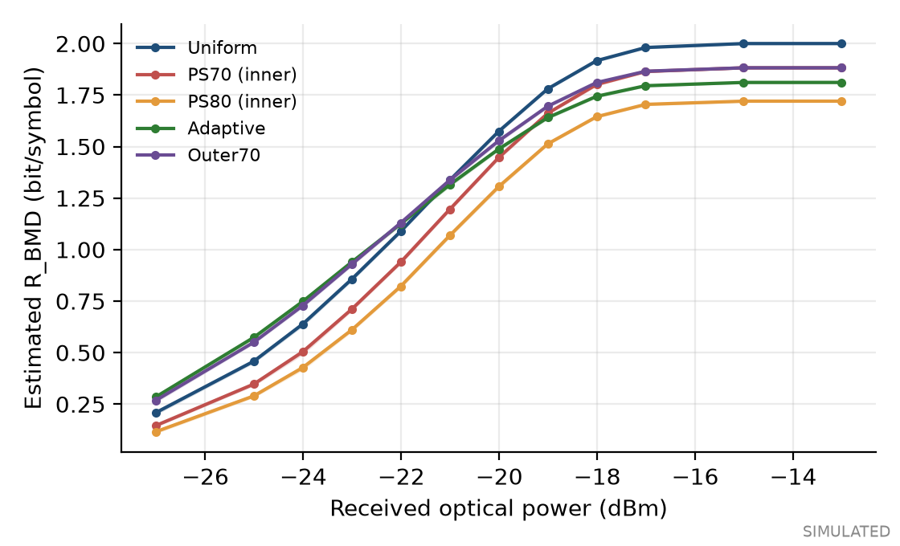

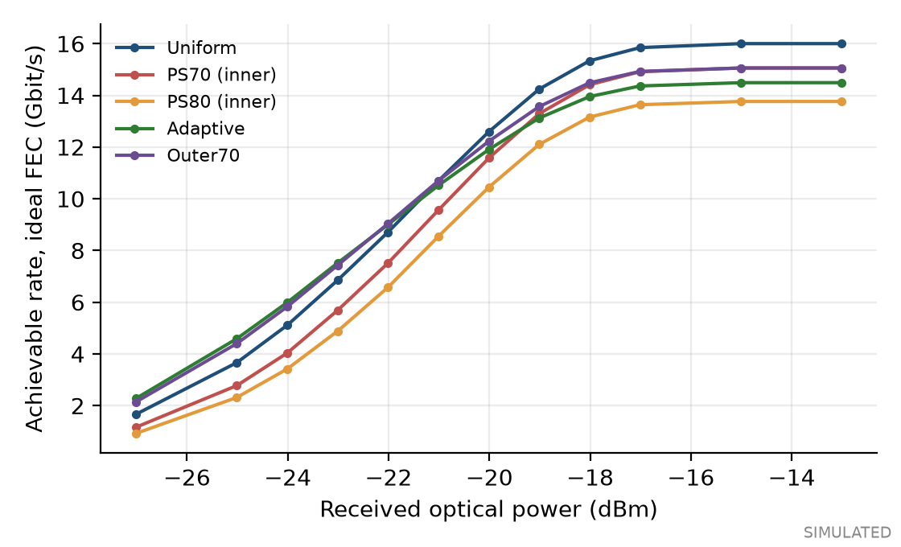

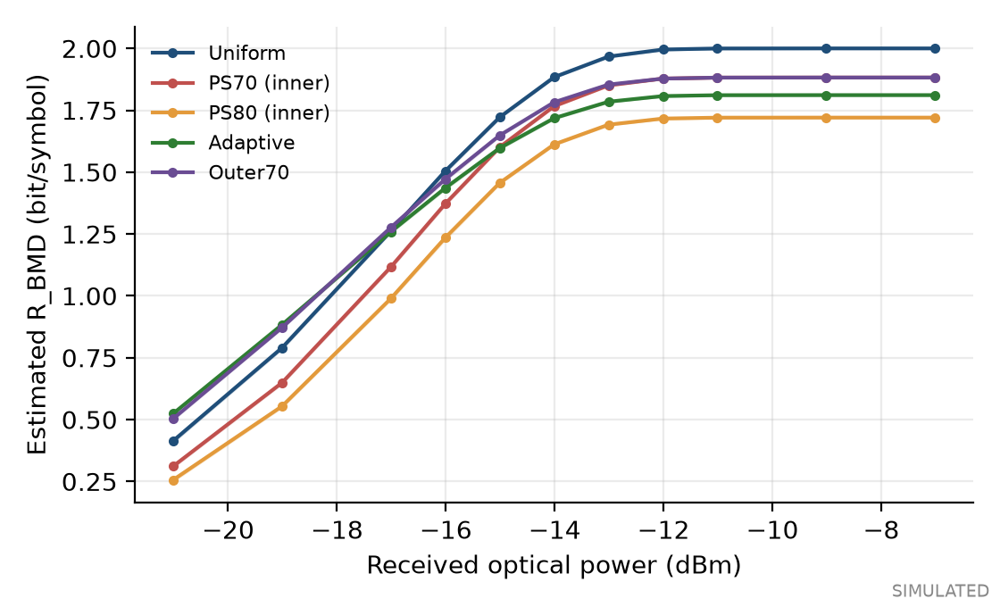

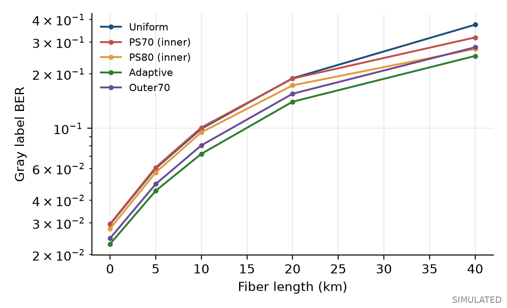

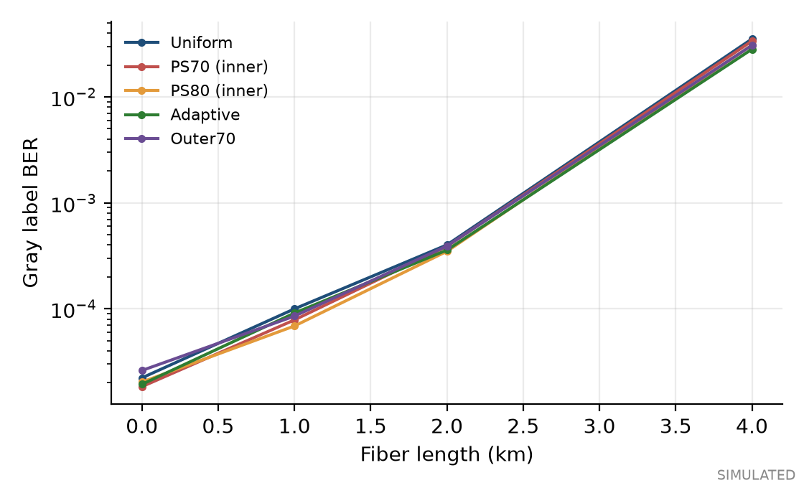

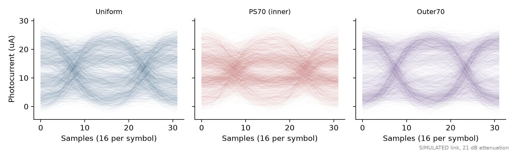

### Adaptive versus fixed on held-out runs

Selection used simulated training runs only. Test runs are held out in noise seeds only: the Uniform training frame and the Uniform contender carry the same symbols. Only one parameter is fitted, so any effect should be small. Values are paired differences in R_BMD, bit/symbol.

| Attenuation | Selected P(+-3) | vs Uniform | vs Outer70 | vs PS70 |
|---|---|---|---|---|
| 26 dB | 0.430 | +0.093 [+0.088, +0.097] | +0.018 [+0.015, +0.022] | +0.237 [+0.234, +0.241] |
| 25 dB | 0.340 | +0.048 [+0.046, +0.050] | +0.001 [-0.001, +0.003] | +0.194 [+0.189, +0.198] |
| 21 dB | 0.250 | +0.000 [-0.001, +0.001] | +0.107 [+0.105, +0.108] | +0.115 [+0.114, +0.117] |

Against the fixed Outer70 distribution, point-by-point adaptation gained at 2, lost at 0, and was unresolved at 1 of 3 operating points.

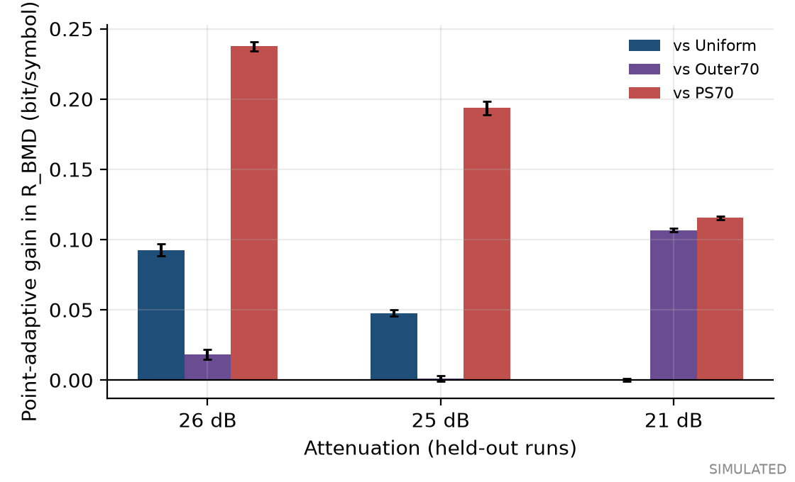

### Protocol B

Target net rate: 14.9375 Gbit/s, computed as baud times matcher bits per symbol. Uniform baud lowered from 8 to 7.4688 GBaud; AWG rate changed to 209.1250 GSa/s. PS70 and Outer70 are matched by construction. This excludes FEC and so is not a coded throughput.

| Attenuation | Configuration | Baud (GBaud) | SER | R_BMD | Achievable (Gbit/s) |
|---|---|---|---|---|---|
| 26 dB | Uniform at matched baud | 7.4688 | 3.46e-01 | 0.894 | 6.68 |
| 26 dB | PS70 (inner) | 8.0000 | 3.65e-01 | 0.711 | 5.69 |
| 26 dB | Outer70 | 8.0000 | 2.79e-01 | 0.934 | 7.47 |
| 25 dB | Uniform at matched baud | 7.4688 | 2.66e-01 | 1.133 | 8.46 |
| 25 dB | PS70 (inner) | 8.0000 | 2.86e-01 | 0.944 | 7.55 |
| 25 dB | Outer70 | 8.0000 | 2.21e-01 | 1.138 | 9.10 |
| 21 dB | Uniform at matched baud | 7.4688 | 1.67e-02 | 1.934 | 14.44 |
| 21 dB | PS70 (inner) | 8.0000 | 2.04e-02 | 1.802 | 14.42 |
| 21 dB | Outer70 | 8.0000 | 1.80e-02 | 1.812 | 14.50 |

## 13. Statistical analysis

Error rates use Clopper-Pearson intervals [14], which stay valid at low counts but assume independent errors, and so are optimistic under ISI. Rates use a percentile bootstrap over independent runs [12, 13], never over samples. Runs differ only in noise and share one symbol sequence and one link, so these narrow intervals describe noise variation only. They are conditional on this payload and link, and say nothing about variation between experiments. Points with fewer than 10 symbol errors appear in figures only as upper bounds. Physical measurement uncertainty does not apply yet: these are simulations.

## 14. Discussion

The requested PS70 and PS80 trade rate away in this model without gaining margin, since inner levels each have two neighbours while the swing and level spacing stay unchanged. That does not make inner-heavy shaping wrong everywhere. With peak unconstrained and noise scaled to average electrical power, PS70 exceeds Uniform between 4 and 11.5 dB SNR, within the computed 4 to 24 dB range. The lower end is the edge of the computed range, not a crossover. Above that, its lower entropy limits it. Such a gain requires a peak swing that an unamplified modulator link may not provide, as [1, 8] discuss.

An outer-heavy input raises electrical RMS, so a real driver may compress it. Sine compression also narrows outer level spacing, which penalizes outer-heavy input and has not been optimized away here. Measured level spacing will decide this.

At high received power, shaped formats are limited by entropy, so Uniform wins. Shaping is only relevant near its design point. Lower BER at equal baud does not imply more throughput.

## 15. Limitations

- Simulation only; one link model; parameters are generic, not Southampton's.
- No FEC, so reported rates are achievable bounds.
- M8199B rules not independently read; playback unverified; DAC code mapping assumed.
- Finite run count; short frames, particularly Profile A.
- AC coupling, baseline wander, connector and driver effects are not modelled.
- Results at one channel condition do not generalize to others.

## 16. Conclusions and future work

Fixed-peak theory and this simulation agree that inner-heavy shaping is the wrong direction for this link class, and that outer-heavy shaping is the candidate worth measuring. Next: run the Southampton back-to-back test of Uniform against Outer70, identify the receiver, verify M8199B file rules, and add a real FEC only if a coded throughput claim is wanted.

## 17. References

1. T. Wiegart et al., Probabilistically shaped 4-PAM for short-reach IM/DD links with a peak power constraint, J. Lightw. Technol. 39(2):400-405, 2021. doi:10.1109/JLT.2020.3029371
2. P. Schulte and G. Boecherer, Constant composition distribution matching, IEEE Trans. Inf. Theory 62(1):430-434, 2016. doi:10.1109/TIT.2015.2499181
3. G. Boecherer, F. Steiner, P. Schulte, Bandwidth efficient and rate-matched low-density parity-check coded modulation, IEEE Trans. Commun. 63(12):4651-4665, 2015. doi:10.1109/TCOMM.2015.2494016
4. G. Boecherer, P. Schulte, F. Steiner, Probabilistic shaping and forward error correction for fiber-optic communication systems, J. Lightw. Technol. 37(2):230-244, 2019. doi:10.1109/JLT.2019.2895770
5. T. M. Cover, Enumerative source encoding, IEEE Trans. Inf. Theory 19(1):73-77, 1973. doi:10.1109/TIT.1973.1054929
6. J. G. Smith, The information capacity of amplitude- and variance-constrained scalar Gaussian channels, Inf. Control 18(3):203-219, 1971.
7. D. M. Arnold et al., Simulation-based computation of information rates for channels with memory, IEEE Trans. Inf. Theory 52(8):3498-3508, 2006. doi:10.1109/TIT.2006.878110
8. Z. He, T. Bo, H. Kim, Probabilistically shaped coded modulation for IM/DD system, Opt. Express 27(9):12126, 2019. doi:10.1364/OE.27.012126
9. J. Wang and K. Petermann, Small signal analysis for dispersive optical fiber communication systems, J. Lightw. Technol. 10(1):96-100, 1992. doi:10.1109/50.108743
10. E. L. Wooten et al., A review of lithium niobate modulators for fiber-optic communications systems, IEEE J. Sel. Topics Quantum Electron. 6(1):69-82, 2000. doi:10.1109/2944.826874
11. F. Gray, Pulse code communication, U.S. Patent 2,632,058, 1953.
12. B. Efron, Bootstrap methods: another look at the jackknife, Ann. Stat. 7(1):1-26, 1979. doi:10.1214/aos/1176344552
13. H. R. Kuensch, The jackknife and the bootstrap for general stationary observations, Ann. Stat. 17(3):1217-1241, 1989. doi:10.1214/aos/1176347265
14. C. J. Clopper and E. S. Pearson, The use of confidence or fiducial limits illustrated in the case of the binomial, Biometrika 26(4):404-413, 1934. doi:10.1093/biomet/26.4.404

## 18. Reproducibility appendix

Command: uv sync, then uv run opticps demo. Data: results/synthetic/demo_results.json. Python 3.11.15, NumPy 2.4.6. Runtime 288 s. Waveform checksums: output/keysight_m8199b/*/checksums.sha256. Decisions and failures: docs/engineering_log/.
